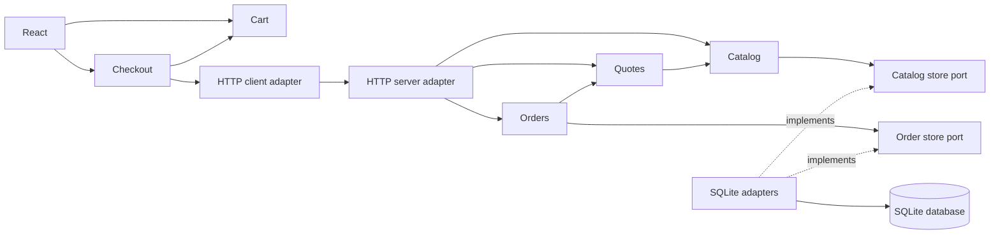

# Field Supply — deep modules in a working application

A small React shop backed by a Bun HTTP server and SQLite. Browse products, build a cart,
apply `TRAIL10`, review the server's quote and place a demo order. No payment is taken.

This application is independent of the slide deck: separate source, build output, server,
database and tests. It shares the repository's Bun workspace and lockfile.

## Run

From the **repository root**, using the pinned Bun version in `package.json`:

```sh
bun install --frozen-lockfile
bun run example-app
```

The command builds the React client, starts the server at **http://127.0.0.1:4174**, and
opens the default browser. Ctrl+C stops the server and closes SQLite. If a browser cannot
be opened on a headless host, the app remains available at the printed URL.

```sh
# Alternative port; leave the browser closed.
PORT=4200 bun run example-app --no-open

# Throwaway database, useful for a demo.
DATABASE_PATH=:memory: bun run example-app

# Build only; output is example-app/dist, not the slide deck's dist.
bun run --cwd example-app build
```

The default database is `example-app/.data/shop.sqlite`, with SQLite's WAL sidecar files.
It is seeded on first use; orders survive restarts. The browser persists its cart in
localStorage. To reset the demo, stop the app, remove the ignored `.data` directory and
clear the site's storage. Tests never use the default database.

Package installs use the host's configured registry. Keep machine-specific registry settings
outside the checkout. After changing dependencies, run `bun run registry:sanitize -- bun.lock`
from the root before committing.

## A deep module per package

Every module has its own `package.json`, explicit dependencies and public `exports`.
Consumers import `@example/quotes`, for example, never another package's `src` files.

```text
example-app/
  apps/
    server/                Process entry, HTTP listener, static assets, shutdown
    web/                   React views, browser lifecycle and localStorage adapter
  packages/
    catalog/               Product discovery and availability semantics
    quotes/                Cart validation, pricing, coupons and shipping
    orders/                Order creation, retries and persisted price snapshots
    cart/                  Quantity rules, restoration, persistence and subscriptions
    checkout/              Async workflow, quote invalidation, retries and disposal
    composition/           WIRING ONLY: server.ts and client.ts
    sqlite-store/          Database/schema ownership and transactional store adapters
    http-server/           HTTP-to-domain translation and error mapping
    http-client/           Fetch adapter, HTTP errors and cancellation
    contracts/             Shared wire types and domain error vocabulary
  packages/*/tests/        Unit/integration tests owned by each module
  packages/composition/
    tests/e2e/             Two real Chromium journeys; wiring owns E2Es only
    playwright.config.ts   Browser/server lifecycle for the E2Es
  apps/web/tests/          React component tests and UI drivers
  tests/architecture/      Cross-package boundary checks
  test-support/            Shared fluent basket builder and backend fixture
  scripts/                 Build, startup and browser launch
```

The domain packages are deep modules. Adapter packages implement their ports; `contracts`
is a deliberately small shared vocabulary. A package does not need a large implementation
to justify its existence. Depth is the complexity hidden from callers, not its line count.

### The composition package only wires modules

The server entry point in `@example/composition/server` is essentially:

```ts
const catalog = createCatalog(store.catalog);
const quotes = createQuotes(catalog);
const orders = createOrders({ quotes, store: store.orders });
return { catalog, quotes, orders };
```

The client entry point in `@example/composition/client` is:

```ts
const cart = createCart(persistence);
const checkout = createCheckout({ cart, api });
return { cart, checkout, dispose: () => checkout.dispose() };
```

There is no pricing, SQL, HTTP routing or React rendering in this package. The application
entries acquire external resources and pass capabilities to it. They own startup and
shutdown; checkout owns its cart subscription and pending-response invalidation.



The composition package connects these objects. It is intentionally omitted from the
runtime-call graph: callers use capabilities, not a service locator.

## What the modules hide

- `quotes.quote(input)` validates the cart, resolves trusted product prices, normalizes a
  coupon, calculates integer-cent totals and applies shipping to the **discounted** subtotal.
  The caller does not sequence those steps. Client-supplied totals are ignored.
- `orders.place(input, requestId)` reprices through the quote capability and saves an immutable
  price snapshot. Retrying the same request and quote returns the original order; reusing
  the key with different quote content returns a conflict. The SQLite adapter writes the
  order and its lines in one transaction, with a unique request ID and foreign keys.
- `cart.add`, `setQuantity`, `clear`, `getSnapshot` and `subscribe` hide quantities,
  persisted-data validation and immutable snapshots. A quantity of zero removes a line.
- `checkout.review` and `place` hide loading/error/confirmation states. Cart changes invalidate
  quotes; late responses cannot overwrite newer state. A failed placement keeps its request
  ID for a retry, and `dispose()` removes the subscription and invalidates pending work.

`TRAIL10` gives a 10% discount. Shipping is €5 below €100 **after** discount, otherwise free.
Each product quantity is limited to 20. Domain modules enforce these rules even when a
caller bypasses the React controls.

## Run the proof

From the repository root:

```sh
# First run on a host without the matching Chromium build:
bun run --cwd example-app/packages/composition test:install-browser

# Type-check and run every example test, including real browser E2Es:
bun run test:example

# Presentation tests remain separate:
bun run test
```

Or run individual layers:

```sh
bun run --cwd example-app typecheck
bun run --cwd example-app test:unit
bun run --cwd example-app test:integration
bun run --cwd example-app test:component
bun run --cwd example-app test:e2e
```

Each module owns its integration tests. Run one package independently, for example:

```sh
bun run --cwd example-app/packages/quotes test
bun run --cwd example-app/packages/cart test
bun run --cwd example-app/apps/web test
bun run --cwd example-app/packages/composition test
```

The layer runner discovers package scripts and runs module suites concurrently. Shared
fixtures remain at the example root; they contain no tests. Only the wiring package owns
E2Es, including their Playwright configuration and browser dependency.

The distribution is a **rhombus**: few isolated units, a broad middle, few E2Es.

| Layer | Tests | What runs |
| --- | ---: | --- |
| Unit | 4 | Isolated pricing policy through the public quote API |
| Integration | 25 | Domain modules, client workflow, HTTP adapters, SQLite and package-boundary checks |
| Component | 6 | React Testing Library in Happy DOM with real modules, real SQL and in-process HTTP |
| E2E | 2 | Real Chromium, compiled React, TCP HTTP server and real SQLite |
| Total | 37 | No skipped tests or automatic retries |

The middle includes malformed input, untrusted prices, coupon recovery, stale async results,
lost-response retries, subscription disposal, database rollback and reopening a file-backed
database. Component tests assert what the user sees, not private implementation calls.

Most integration tests use a separate SQLite `:memory:` connection per scenario. This keeps
SQL behavior real while removing disk/network setup. The persistence test uses a temporary
database file and closes/reopens it. Independent compositions can run concurrently without
sharing state; an isolation test proves that. Test drivers clean up resources after each case.

E2Es use a dedicated server on port 4186 with an isolated in-memory SQLite database. They do
not reuse a manually running server or alter your demo data. Set `E2E_PORT` if needed.
Failure traces are in the ignored `example-app/test-results` directory. The browser tests
cover desktop purchase/confirmation, reading the saved order through HTTP, mobile cart reload,
and invalid coupon recovery. Desktop and mobile screenshots are saved beside the test results.
They do not mock the network or database.

## HTTP contract

| Request | Result |
| --- | --- |
| `GET /api/health` | Readiness response |
| `GET /api/catalog` | Available products and prices |
| `POST /api/quotes` | Quote for `{ items: [{ productId, quantity }], coupon? }` |
| `POST /api/orders` | Persisted order; same body, plus `Idempotency-Key` header |
| `GET /api/orders/:id` | Persisted price snapshot |

## Deliberate demo scope

This is a single-user local shop, not a production commerce service. It has no authentication,
payments, stock reservations or personal data. Prices are static seed data. The schema is
created on startup; evolving a deployed database would need versioned migrations. An order
retry compares the quoted content, so changing catalog prices between attempts can produce
a conflict. Multiple server processes would need explicit handling for simultaneous writes
using the same request key. Those concerns belong behind the relevant module boundaries,
not in the composition package.
